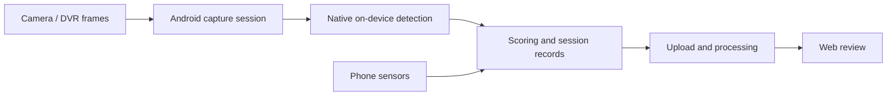

# Android Scoring & On-Device Inference

*A personal portfolio case study of a team-built Android product. It contains no company source code, model weights, customer data, internal endpoints, credentials, or deployment configuration.*

## What the product does

The Android app supports an in-vehicle scoring session: preparing the device and camera, capturing a live stream, running visual recognition on the phone, collecting sensor and session data, and sending the resulting records for later review. “Scoring” here means evaluating a driving session; it is not a published hardware benchmark score.

## Technical flow

The implementation uses Kotlin for the Android session and UI, a foreground service for long-running work, JNI/C++ for the native vision boundary, and ncnn for on-device model execution. The Android and iOS clients also use a shared C++ layer for selected vision and data-processing components, with platform-specific wrappers.

## Engineering concerns

- **Session readiness:** Check permissions, device connection, network access, and model availability before scoring starts.
- **Lifecycle:** Keep capture, detection, and session state coordinated when the app moves between foreground and background.
- **Model loading:** Download and validate model packages, then load them through a controlled native boundary.
- **Recovery:** Make interruption and upload states visible, so a user can understand whether a session completed.
- **Cross-platform reuse:** Keep suitable C++ logic shared while respecting Android and iOS lifecycle differences.

## My role

I worked on the application and integration side of this broader team product, including the scoring workflow and the connections between mobile capture, native inference, and downstream records. This is a summary of the system and my contribution, not a claim that I independently built the full Android app or trained the models.

## Evidence and limits

This case study is based on the local Android project and its technical documentation. The workflow and stack above are supported by the implementation. I have not published device-specific latency, FPS, accuracy, or scoring results because I do not have a verified, shareable benchmark record with the device, model version, input size, and measurement method.

For a suitable walkthrough, please contact me through my [GitHub profile](https://github.com/Deng-summer).

© 2026 Deng-summer. Personal portfolio summary; not official company documentation.
